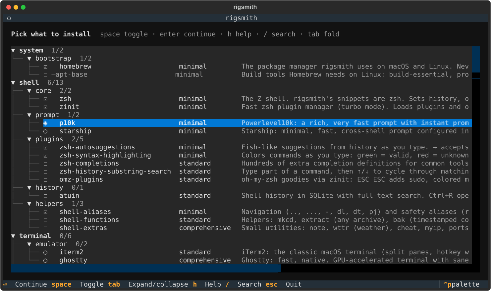
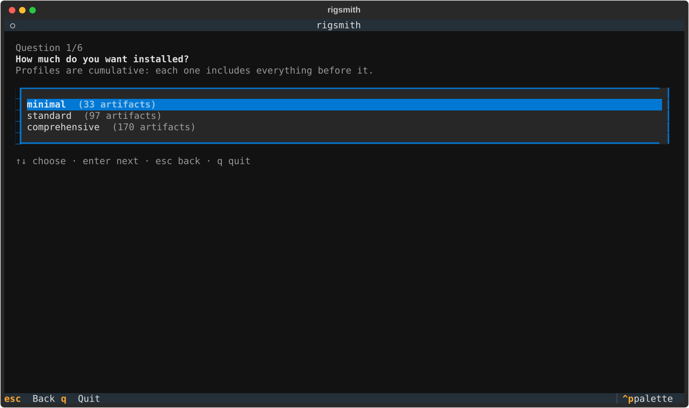
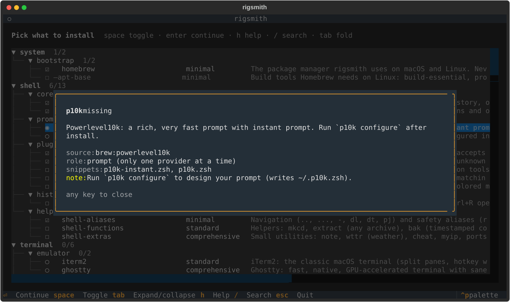
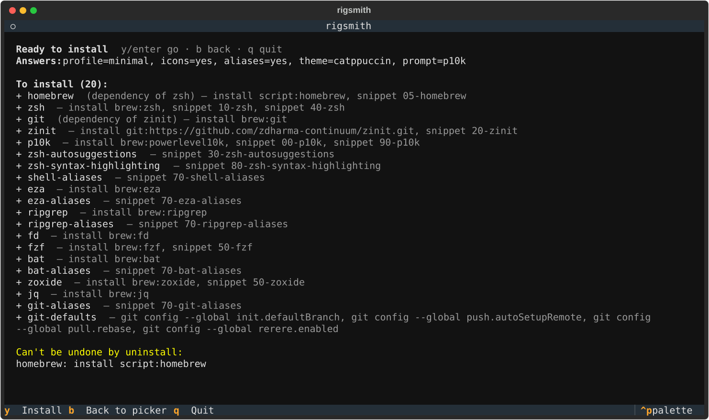

# rigsmith

[](https://github.com/slimfrkha/rigsmith/actions/workflows/ci.yml)
[](https://github.com/slimfrkha/rigsmith/actions/workflows/e2e.yml)

Set up a fresh macOS or Linux machine from a curated library of developer tools and the config that
makes them work, then see what's installed and undo it cleanly.

```sh
curl -fsSL https://raw.githubusercontent.com/slimfrkha/rigsmith/main/install.sh | sh -s -- install
```

A short questionnaire, a picker where you can tick or untick anything, a summary of exactly what will
change, then one install after the other. **[Browse the catalog →](docs/CATALOG.md)** 220+ tools across
shell, CLI, git, Python, Go, Rust, Java, JS, containers, Kubernetes, cloud, IaC, data, ML and VS Code.



## Contents

- [Commands](#commands)
- [How it's organized](#how-its-organized)
- [Safe by design](#safe-by-design)
- [Configs](#configs)
- [Add your own tools](#add-your-own-tools)
- [Platforms](#platforms)
- [Development](#development)

## Commands

| Command | What it does |
|---|---|
| `rigsmith install` | Questionnaire → picker → summary → install. `-y` skips the screens and uses defaults. |
| `rigsmith scan` | What's installed, partial, missing or unavailable, by section. `--all` scans the whole library. |
| `rigsmith uninstall` | Undo what rigsmith installed, from its receipts. Things you had before are left alone. |
| `rigsmith init` | Create your own config: pick artifacts and profiles, then optionally restructure in `$EDITOR`. |

Every command takes the same filters:

```sh
rigsmith install -p standard -s python -s kubernetes   # standard profile, two sections
rigsmith install fzf zoxide                            # just these
rigsmith scan -s cli/search                            # a subsection
rigsmith install -c example -y                         # someone else's config, no questions
rigsmith install --dry-run                             # show the plan, change nothing
```

`-s` and `-p` combine as **OR within a flag, AND across flags**. Artifact ids narrow the result further.

## How it's organized

- **Artifact**: one installable unit: a package plus the config the tool needs to work (a zsh snippet,
  a file, a few settings). `fzf` brings its key bindings, `gcloud` its PATH and completion.
  Optional taste (aliases, themes, preferred settings) lives in separate artifacts such as `eza-aliases`.
- **Section / subsection**: what a tool *is*: `cli/search`, `kubernetes/logs`, `python/vscode`.
- **Profile**: how much you want: `minimal ⊂ standard ⊂ comprehensive`. Profiles are cumulative.
- **Role**: tools that can't coexist, such as two prompts (`p10k` / `starship`) or two container runtimes.
  The picker shows them as radio buttons. A provider that's already installed is always kept unless you pick another one.
- **Question**: the questionnaire is built from the artifacts in your config. Each question is
  asked only if something in scope cares about it: icons, aliases, full-screen TUIs, fun stuff, color theme.

| | |
|---|---|
|  |  |

In the picker: `space` toggles, `h` explains the row, `/` searches, `tab` folds a section, `enter` continues.

## Safe by design

- **Your `~/.zshrc` is never overwritten.** rigsmith adds one marked block at the top that sources
  `~/.config/rigsmith/init.zsh`, which sources one small file per tool from `~/.config/rigsmith/shell.d/`.
  Your own lines stay below the block and win. Before the first install, rigsmith warns about lines in
  your `~/.zshrc` that would load the same things twice.
- **Every change gets a receipt** in `~/.local/state/rigsmith/state.json`, recording what it was before and what rigsmith
  left behind. `uninstall` reverses only what rigsmith did, and only if it's still what rigsmith left. If you
  edited a file or changed a setting since, your version is kept with a warning.
- **Things you already had stay put.** A tool that was installed before shows as `pre-existing` and isn't
  removed (unless you pass `--include-unmanaged`).
- **Irreversible steps are listed before you confirm**, such as installing Homebrew or importing shell history.
- **Idempotent**: running `install` again reports `0 changes`. CI checks this on real macOS and Ubuntu
  machines, along with uninstall restoring `~/.zshrc` byte for byte.



## Configs

A config is a menu: which artifacts are in scope, in which section, at which profile.

| Config | |
|---|---|
| [`config/reference.yaml`](config/reference.yaml) | The whole library. Used when you have no config of your own. |
| [`config/example.yaml`](config/example.yaml) | The author's setup (zsh, k9s, GCP, Terraform, VS Code), with every answer pinned. |
| `~/.config/rigsmith/config.yaml` | Yours, written by `rigsmith init`. Used automatically when it exists. |

`-c` takes a path or a bundled name: `rigsmith install -c example`.

```yaml
profiles: [minimal, standard, comprehensive]
sections:
  cli:
    search: {ripgrep: minimal, fzf: minimal, fd: standard}
  shell:
    prompt: {p10k: minimal, starship: minimal}   # same role: one of them
answers:          # pre-answers: used by -y, and as defaults in the questionnaire
  prompt: starship
  icons: "yes"
questions:
  skip: [fun]
```

A config fully replaces the reference. When the library gains artifacts your config doesn't list,
`scan` says so (`scan --all --new` lists them, and `init --from <your config>` offers them unticked).

**Reproducible bootstraps** (CI, servers): pin the rigsmith version *and* every answer:

```sh
curl -fsSL https://raw.githubusercontent.com/slimfrkha/rigsmith/v0.1.0/install.sh \
  | RIGSMITH_VERSION=0.1.0 sh -s -- install -c my-config.yaml -y
```

## Add your own tools

The simple case is a few lines of YAML in your config:

```yaml
custom:
  - {id: btop, help: "Resource monitor", brew: btop, apt: btop}
sections:
  extra:
    tools: {btop: minimal}
```

For anything else, drop a Python file in `~/.config/rigsmith/artifacts/`:

```python
from rigsmith.backends import Brew, Cask
from rigsmith.model import Artifact, Snippet

Artifact(
    id="wezterm",
    help="GPU-accelerated terminal configured in Lua.",
    sources=[Cask("wezterm", os="darwin"), Brew("wezterm")],
    check="test -d /Applications/WezTerm.app || command -v wezterm",
    role="terminal",
)
```

Backends: `Brew`, `Cask`, `Apt`, `Krew`, `VSCodeExt`, `UvTool`, `Script`, `GitClone`, `NerdFont`.
Artifacts can also own zsh snippets (`shell=Snippet(...)`), whole files (`files=[File(...)]`), VS Code and
git settings (`settings=[VSCodeSetting(...), GitConfig(...)]`), a role, tags and notes. See
[DESIGN.md](DESIGN.md) for the full model.

Want a tool in the built-in library? Open an issue with the **New artifact** template. The bar is a widely used,
maintained tool that installs with Homebrew on macOS and Homebrew or apt on Linux.

## Platforms

macOS 14+ (Apple Silicon and Intel), Ubuntu 22.04 / 24.04 and Debian 12 (amd64, arm64). Homebrew is the
primary package manager on both, with apt for the few things that need it. zsh only, for now.

## Development

```sh
uv sync
uv run pytest                        # unit, library lint, CLI and TUI tests (never touch your machine)
uv run ruff check . && uv run ty check src
uv run python scripts/check_sources.py   # every brew name and VS Code extension id exists
```

The real install/uninstall cycle runs in CI only ([e2e.yml](.github/workflows/e2e.yml)): never run
`tests/e2e/run.sh` on a machine you care about.

## License

[MIT](LICENSE)
