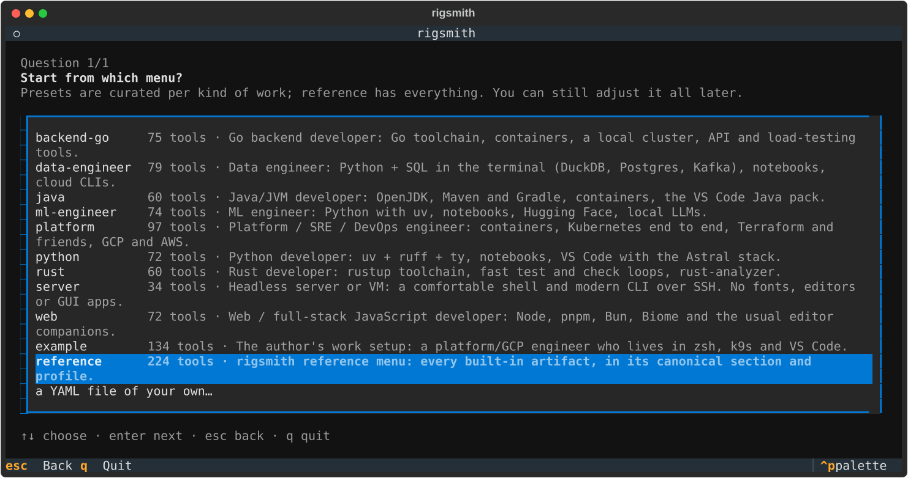

# rigsmith

[](https://github.com/slimfrkha/rigsmith/actions/workflows/ci.yml)
[](https://github.com/slimfrkha/rigsmith/actions/workflows/e2e.yml)
[](https://pypi.org/project/rigsmith/)

Set up a fresh macOS or Linux machine from a curated library of 220+ developer tools and the config that makes
them work (shell, CLI, git, Python, Go, Rust, Java, JS, containers, Kubernetes, cloud, IaC, data, ML, VS Code), then
see what's installed and undo it cleanly.


**Use it if** you want a good terminal and toolchain on a new machine in minutes, picked from presets instead of
copied from old dotfiles, and removable without leftovers.

**Look elsewhere if** you need per-project package isolation or fully declarative machines (that's
[Nix](https://nixos.org)), or a shell other than zsh (zsh only, for now).

## Install

```sh
curl -fsSL https://raw.githubusercontent.com/slimfrkha/rigsmith/main/install.sh | sh -s -- install
```

The script installs [uv](https://docs.astral.sh/uv/) if it's missing, then runs rigsmith. If you already have uv:
`uvx rigsmith install`.

Supported: macOS 14+ (Apple Silicon and Intel), Ubuntu 22.04 / 24.04, Debian 12 (amd64, arm64). Homebrew is the
package manager on both, with apt for the few things that need it.

## Quickstart

1. Pick a preset for your kind of work:

   ```sh
   rigsmith use platform
   ```

   ```text
   ✓ now using your config (~/.config/rigsmith/config.yaml, from platform): 97 artifacts
   ```

2. See what would change, without changing anything:

   ```sh
   rigsmith install --dry-run
   ```

   ```text
   config: your config (~/.config/rigsmith/config.yaml, from platform)
   Answers: profile=standard, icons=yes, aliases=yes, tui=yes, theme=catppuccin, container-runtime=colima

   Already in place (29): git, eza, ripgrep, fd, bat, jq, gh, vscode, kubectx, k9s, terraform, …

   To install (55):
     + zsh — snippet 10-zsh, snippet 40-zsh
     + zinit — install git:https://github.com/zdharma-continuum/zinit.git, snippet 20-zinit
     + starship — snippet 90-starship
     …
   ```

   What's "already in place" depends on your machine: those are left alone.

3. Install: `rigsmith install`. A short questionnaire and a picker let you change anything before a final
   confirmation, then tools install one after the other. Open a new terminal when it's done.

## Commands

| Command | What it does |
|---|---|
| `rigsmith use [preset\|path]` | Pick your config (a copy you can edit). No argument opens a picker |
| `rigsmith install [ids]` | Questionnaire → picker → summary → install. `-y` skips the screens, `--dry-run` only shows the plan |
| `rigsmith scan [ids]` | What's installed, partial, missing or unavailable, and whether rigsmith or you installed it |
| `rigsmith uninstall [ids]` | Undo what rigsmith installed, from its receipts. Tools you had before stay |
| `rigsmith init` | Tailor a config: tick tools, set profiles, optionally edit the YAML |

`install`, `scan` and `uninstall` filter with `-c CONFIG`, `-p PROFILE`, `-s SECTION[/SUB]` and artifact ids.
Every flag is in the [reference](docs/reference.md#commands).

## Presets

| Preset | For |
|---|---|
| [`python`](config/presets/python.yaml) | uv + ruff + ty, notebooks, VS Code with the Astral stack |
| [`backend-go`](config/presets/backend-go.yaml) | Go toolchain, containers, a local cluster, API and load-testing tools |
| [`rust`](config/presets/rust.yaml) | rustup, bacon, nextest, rust-analyzer |
| [`java`](config/presets/java.yaml) | OpenJDK, Maven, Gradle, the VS Code Java pack |
| [`web`](config/presets/web.yaml) | Node, pnpm, Bun, Biome, ESLint/Prettier, Tailwind |
| [`data-engineer`](config/presets/data-engineer.yaml) | Python + SQL in the terminal (DuckDB, Postgres, Kafka), notebooks, cloud CLIs |
| [`ml-engineer`](config/presets/ml-engineer.yaml) | Python with uv, notebooks, Hugging Face, local LLMs |
| [`platform`](config/presets/platform.yaml) | Containers, Kubernetes end to end, Terraform and friends, GCP and AWS |
| [`server`](config/presets/server.yaml) | A headless box over SSH: shell and modern CLI, no fonts or GUI apps |

The developer presets share a base (zsh, starship, fzf, ripgrep, eza, zoxide, git, lazygit, VS Code); `server` keeps
only the shell and CLI part. Every preset pins its answers, so `-y` gives the same result every time. [`reference`](config/reference.yaml) has every tool;
[`example`](config/example.yaml) is the author's own setup. The first `rigsmith install` asks which to start from:



## How it works

- **Artifact:** one installable unit: a package plus the config the tool needs to work (a zsh snippet, a few
  settings). Optional taste, like aliases or a theme, is a separate artifact you can leave out.
- **Section:** what a tool is (`cli/search`, `kubernetes/logs`). **Profile:** how much you want
  (`minimal ⊂ standard ⊂ comprehensive`).
- **Role:** tools that can't coexist, such as two prompts. You get one, and a tool you already have is kept.
- **Questions** are built from what's in scope: icons, aliases, full-screen apps, theme, your work folder and email.

| | |
|---|---|
|  |  |

## Safe by design

- **Your `~/.zshrc` is never overwritten.** rigsmith adds one marked block at the top; your own lines stay below and
  win.
- **Every change gets a receipt**, recording the value before and the value rigsmith left. `uninstall` undoes only
  what rigsmith did, and keeps anything you changed since.
- **Steps that can't be undone are listed before you confirm**, such as installing Homebrew.
- **Nothing is a black box.** `--script` prints every command an install or uninstall would run, for reading
  ([why you shouldn't run it yourself](docs/guide.md#see-what-rigsmith-would-run)).
- **Running it again changes nothing.** CI installs, reinstalls (expecting 0 changes) and uninstalls on real macOS
  and Ubuntu machines, and checks `~/.zshrc` comes back byte for byte.


## Where next

| To | Read |
|---|---|
| choose, tailor or switch configs; per-project setups; add your own tools | [Guide](docs/guide.md) |
| look up a flag, config key, artifact field or file | [Reference](docs/reference.md) |
| browse every tool rigsmith can install | [Catalog](docs/CATALOG.md) |
| understand how it works and why | [Design](DESIGN.md) |
| contribute, add a tool to the library, release | [Contributing](CONTRIBUTING.md) |
| report a vulnerability | [Security](SECURITY.md) |

## License

[MIT](LICENSE)
